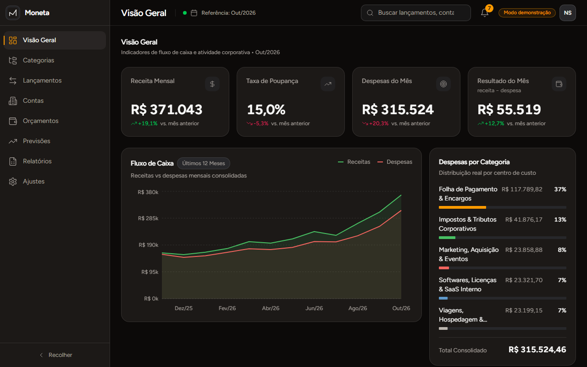
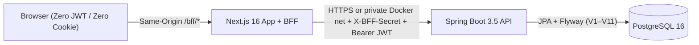

<div align="center">

# Moneta

**Fullstack corporate finance platform powered by a Spring Boot 3 REST API, a zero-token Next.js 16 BFF proxy, and PostgreSQL 16.**

[Português](README.md) · English

[Deployment Guide](DEPLOY.md) · [Architecture & Security](SECURITY.md) · [Technical Docs](docs/README.md) · [MIT License](LICENSE)




</div>

---

## Why this project exists

Corporate finance software demands exact monetary arithmetic, strict account isolation, and zero credential exposure in the browser. **Moneta** pairs a **Java 17 / Spring Boot 3.5 REST API** with a **Next.js 16 dashboard** running as a public login-free demo: neither JWTs, session cookies, nor the backend internal origin ever leave the server.

---

## Architecture



Threat model, headers, and production hardening details are documented in [`SECURITY.md`](SECURITY.md) and [`docs/`](docs/README.md).

---

## Key Capabilities

### Back-end (`moneta-api`)

Layered Spring Boot architecture (`Controller` → `Service` → `Repository`) with **12 domain controllers** backed by PostgreSQL 16:

- **Monetary precision and immutability:** `BigDecimal` domain logic backed by `NUMERIC(19,2)` columns, `CHECK (amount > 0)` database constraints, and Java `record` DTOs.
- **Deterministic domain rules:**
  - Rejects zero or negative transaction amounts (`400 Bad Request`).
  - Blocks future-dated expenses using an injectable `java.time.Clock` (`422 Unprocessable Entity`).
  - Requires existing transaction history before balance calculation (`422 Unprocessable Entity`).
  - Protects referential integrity when deleting categories with linked entries (`409 Conflict`).
- **Anti-enumeration multi-tenant isolation:** queries filter strictly by `userId` (`findByIdAndUserId`); cross-tenant access attempts return `404 Not Found` instead of `403` to prevent ID enumeration.
- **Database performance and server-side PDF:** 11 Flyway migrations (`V1–V11`) including `INCLUDE` covering indexes (`V11`), `@EntityGraph` against N+1 queries, `spring.jpa.open-in-view=false`, `X-Total-Count` pagination, HTTP Gzip compression, and server-rendered PDF reports via Thymeleaf + OpenHTMLtoPDF (logo uploads limited to PNG/JPG up to 1 MB; SVG blocked against stored XSS).
- **Production profile (`prod`) hardening:** `BffSecretFilter` requiring `X-BFF-Secret` (>= 32 chars, constant-time `MessageDigest.isEqual` check), `DemoReadOnlyFilter` blocking demo account writes directly at the API Servlet layer (`403 DEMO_READ_ONLY`), public registration `/api/auth/register` and Swagger/OpenAPI disabled, strict CORS, and Actuator restricted to `/actuator/health`.

### Front-end + BFF (`moneta-dashboard`)

Built with **Next.js 16 (App Router), React 19, TypeScript, and Tailwind CSS v4**, using **Inter** (SemiBold headings & metrics) paired with **IBM Plex Mono** for tabular values and endpoints:

- **8 operational views:** Overview (KPIs, 12-month cash flow chart, top categories), Categories (Kanban board with instant search, clickable category jump pills, top pagination, and flat scrollable columns without nested card boxes), Transactions (filters, sorting, pagination), Accounts & Contacts, Cost-Center Budgets, Forecasting & Risk Mitigation, PDF Reports, and Settings (including a dedicated **API & Security** tab).
- **Zero-token BFF proxy:** [`demo-session.ts`](moneta-dashboard/lib/server/demo-session.ts) keeps the service JWT strictly in server RAM with `single-flight` concurrency control, proactive refresh (60s before expiry), and automatic `401` retry.
- **Edge safeguards:** strict 11-resource `/api/*` allowlist, path-traversal and SSRF blocking, CSRF validation (`Origin` & `Sec-Fetch-Site`), sliding-window rate limiting, 64 KB payload limit, CSP/HSTS headers, and deterministic `America/Sao_Paulo` SSR calendar resolution.

---

## Engineering Trade-offs

| Decision | Why | Discarded alternative |
|---|---|---|
| **In-memory JWT in BFF + `single-flight`** | Zero client token leakage and prevents concurrent login storms. | JWT in `localStorage` or browser cookie |
| **Return `404` on cross-user access** | Prevents attackers from enumerating valid foreign resource IDs. | Returning `403 Forbidden` |
| **PostgreSQL 16 + Flyway (`V1–V11`)** | Transactional guarantees, `NUMERIC(19,2)`, and `INCLUDE` indexes. | `ddl-auto: update` or in-memory DB |
| **Injectable `Clock` in API services** | Keeps date-sensitive business rules deterministic in tests. | Calling `LocalDate.now()` directly |
| **`next/dynamic` + optional standalone output** | Reduces initial client bundle and produces lean Docker images without breaking Vercel builds. | Eager monolithic imports |

---

## Repository Structure

```text
moneta-deploy/
├── .github/workflows/ci.yml        # GitHub Actions CI (Maven verify + Lint/TSC/Build)
├── db/
│   ├── demo/                       # Realistic 12-month synthetic dataset (3,811 txs)
│   └── loadtest/                   # Load-testing SQL seed scripts
├── docs/                           # Architecture, design system, and planning docs
├── moneta-dashboard/               # Next.js 16 App Router + BFF proxy + Playwright E2E
│   ├── app/                        # App routes, /bff/* handlers, error boundaries
│   ├── components/                 # Sections, modals, charts, and shadcn/Luma UI
│   ├── e2e/                        # Playwright E2E suite (smoke + visual snapshots)
│   └── Dockerfile                  # Multi-stage standalone image (Node 22 Alpine)
├── src/                            # Spring Boot 3.5 REST API + Flyway migrations + tests
├── DEPLOY.md                       # Deployment guide (Vercel, Render, Railway & VPS)
├── SECURITY.md                     # Threat model and implemented controls
├── Dockerfile                      # Multi-stage API image (Eclipse Temurin 17)
├── docker-compose.yml              # PostgreSQL + API (+ fullstack profile with Dashboard)
└── render.yaml                     # Render Docker Blueprint for moneta-api
```

---

## Running Locally & Deploying

### Option 1 — Full-stack Docker Compose (API + PostgreSQL + Dashboard)

```bash
cp .env.example .env
# Set POSTGRES_PASSWORD, JWT_SECRET, and DEMO_PASSWORD inside .env
docker compose --profile fullstack up -d --build
```

To run only **PostgreSQL + API** in containers:

```bash
docker compose up -d --build
```

Ports bind exclusively to loopback (`127.0.0.1:5433` for Postgres, `127.0.0.1:8081` for API, `127.0.0.1:3000` for Dashboard). Seed the 12-month synthetic demo dataset with:

```bash
docker cp db/demo finance-db:/tmp/demo
docker exec finance-db psql -U finance -d finance -v ON_ERROR_STOP=1 -f /tmp/demo/01_seed_demo_company.sql
docker exec finance-db psql -U finance -d finance -v ON_ERROR_STOP=1 -f /tmp/demo/03_verify_demo_company.sql
```

### Option 2 — Local Node.js Dashboard

```bash
cd moneta-dashboard
cp .env.example .env.local
npm install
npm run build
npm run start
```

The BFF defaults to **`DEMO_MODE=readonly`** (`403 DEMO_READ_ONLY` on mutations). Switch to `DEMO_MODE=sandbox` in `moneta-dashboard/.env.local` to test writes locally.

### Option 3 — Cloud Deployment (Vercel + Render / Railway or VPS)

See [`DEPLOY.md`](DEPLOY.md) for environment variable checklists, production BCrypt demo password rotation, DNS, and rollback procedures.

---

## Quality & Testing

- **Back-end (`./mvnw -B verify`):** **90 Java tests across 17 executable suites** (18 test files with `BaseIntegrationTest`; unit + **Testcontainers PostgreSQL 16** integration suites including `prod` security hardening coverage).
- **Front-end (`moneta-dashboard`):** `npx tsc --noEmit`, `npm run lint`, and `npm run build` pass with zero errors.
- **Playwright E2E (`moneta-dashboard/e2e/`):** **32 checks** (**16 smoke** + **16 visual baselines** across desktop `1440×900` and mobile `375×812`, run with `--workers=1` to stay within the BFF's `300 req/min` rate limiter).
- **CI (GitHub Actions):** configured in [`.github/workflows/ci.yml`](.github/workflows/ci.yml).

---

## Known Limitations

- The BFF rate limiter runs in-memory per Node.js process (multi-replica serverless deployments should pair it with edge WAF/Redis rate limiting).
- In `sandbox` mode, visitors share the same synthetic demo account.

## Credits & License

- Base UI: [shadcn/ui](https://ui.shadcn.com) and [Radix UI](https://www.radix-ui.com) (MIT) · Icons: [Lucide](https://lucide.dev) (ISC).
- Typography: **Inter** and **IBM Plex Mono** (OFL-1.1).
- Licensed under the **MIT License** ([`LICENSE`](LICENSE)).

---

## Author

**Apaminondas** · [GitHub](https://github.com/Apaminondas) · [LinkedIn](https://www.linkedin.com/in/apaminondas-de-moura-lima-neto-55606a300/)
