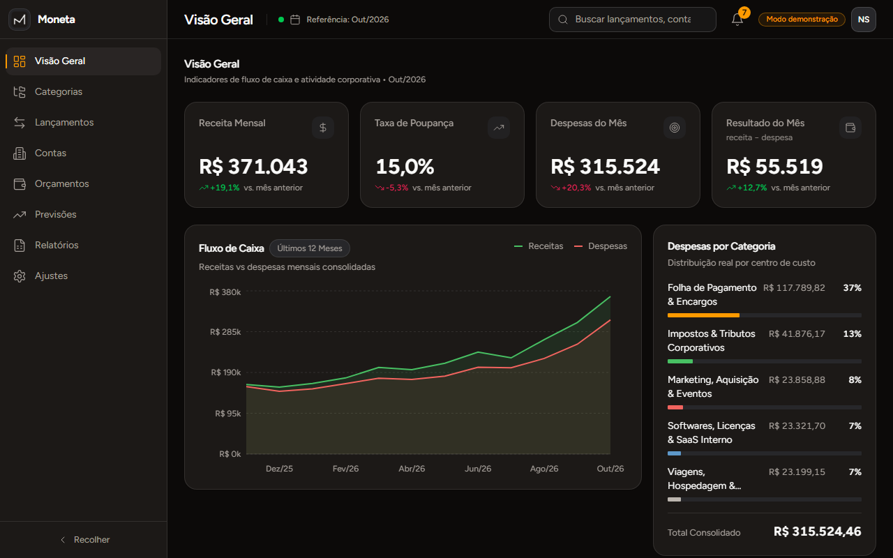
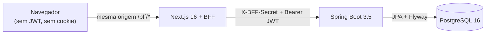

<div align="center">

# Moneta

**Gestão financeira corporativa com API REST em Java e dashboard em Next.js, onde o navegador nunca recebe token.**

[Segurança](SECURITY.md) · [Guia de deploy](DEPLOY.md) · [Licença MIT](LICENSE)




</div>

> **Status:** funcional e testado; demo pública em publicação. Todos os dados exibidos são sintéticos (empresa fictícia).

---

## O problema

Sistemas financeiros feitos às pressas costumam falhar em três pontos:

1. **Dinheiro em ponto flutuante:** `float` e `double` acumulam diferenças de centavos em conciliações, relatórios e tetos mensais.
2. **Vazamento entre contas:** buscar por ID sem filtrar o dono do registro, ou responder `403` em recurso alheio, revela quais IDs existem.
3. **Credencial no navegador:** JWT em `localStorage` ou em cookie legível aumenta o estrago de qualquer falha de XSS.

O Moneta trata os três como requisito, não como detalhe.

## O que ele faz

Dashboard com 8 módulos, todos integrados à API:

- **Visão Geral:** KPIs do mês, fluxo de caixa de 12 meses e maiores categorias
- **Categorias:** visão em Kanban
- **Lançamentos:** filtros, ordenação e paginação
- **Contas e Parceiros**
- **Orçamentos:** tetos por centro de custo e aderência
- **Previsões e Riscos:** projeções e planos de mitigação
- **Relatórios:** PDF gerado no servidor
- **Ajustes**

## Arquitetura



O navegador só conversa com o próprio Next.js. O BFF autentica no servidor com uma conta de demonstração, mantém o JWT apenas em memória (com `single-flight` e renovação 60 s antes de expirar) e repassa as chamadas à API. A URL da API e as credenciais ficam em variáveis de ambiente do servidor.

## Decisões de engenharia

| Decisão | Motivo | Efeito |
|---|---|---|
| `404` em vez de `403` em recurso de outro usuário | Impedir que alguém descubra IDs válidos | Todas as consultas passam por `findByIdAndUserId`, com teste de isolamento |
| JWT só na memória do BFF | Tirar credencial do navegador | Um XSS não consegue roubar token |
| `BigDecimal` + `NUMERIC(19,2)` + `CHECK (amount > 0)` | Exatidão decimal com defesa em profundidade no banco | Sem arredondamento binário nem valores zero ou negativos |
| `Clock` injetável | Regras que dependem de data ficam testáveis | Despesa com data futura (`422`) vira teste determinístico |
| Período de referência único no dashboard | Totais iguais em todas as telas | Corrige a divergência que existia entre servidor (UTC) e dados do seed |
| Trava dupla na API em produção | A API pode ter URL pública em hospedagem gratuita | `BffSecretFilter` e `DemoReadOnlyFilter` recusam chamadas diretas e escrita da conta demo |
| Flyway (11 migrations), `@EntityGraph`, `open-in-view=false` | Banco versionado e sem consultas N+1 | Índices de cobertura `INCLUDE` nas agregações |

### Regras de negócio (todas com teste)

| Regra | Resposta |
|---|---|
| Valor de lançamento deve ser positivo | `400` |
| Despesa não pode ter data futura | `422` |
| Recurso de outro usuário | `404` |
| Saldo exige ao menos um lançamento | `422` |
| Categoria com lançamentos não pode ser excluída | `409` |
| Token ausente ou expirado | `401` |

## Segurança

Resumo dos controles que existem no código (detalhes e limitações em [`SECURITY.md`](SECURITY.md)):

- **API:** JWT stateless, isolamento por usuário, `X-BFF-Secret` obrigatório em `/api/**` no perfil `prod`, cadastro desabilitado em produção, escrita da conta demo bloqueada, Swagger desligado em `prod`, Actuator limitado a `health`, CORS por variável de ambiente.
- **BFF:** allowlist de 11 recursos `api/*`, rejeição de path traversal, proteção CSRF (`Origin` e `Sec-Fetch-Site`), limite de 64 KB por requisição, timeouts de 10 s (30 s em PDF) e rate limit por janela deslizante (120 req/min no geral, 20 em relatórios, 30 em escrita).
- **Navegador:** CSP, `nosniff`, `Referrer-Policy`, `Permissions-Policy` e HSTS em produção.
- **Modo da demo:** `readonly` por padrão (escritas recebem `403 DEMO_READ_ONLY`); `sandbox` para uso local.

## API

Swagger local em `http://localhost:8081/swagger-ui.html` (desligado em `prod`). Alguns endpoints representativos:

| Método e rota | Comportamento |
|---|---|
| `POST /api/transactions` | Valida valor `> 0` (`400`), categoria do próprio usuário (`404`) e bloqueia despesa futura (`422`) |
| `GET /api/transactions` | Lista paginada com `X-Total-Count` e filtros por categoria, tipo e período |
| `DELETE /api/categories/{id}` | `204`, ou `409` se houver lançamentos vinculados |
| `GET /api/summary/monthly` | Receitas, despesas e saldo do mês em `BigDecimal` |
| `GET /api/reports/monthly/pdf` | PDF gerado no servidor (Thymeleaf + OpenHTMLtoPDF) |

## Testes e qualidade

- **Back-end:** 90 testes (JUnit 5, Mockito e Testcontainers com PostgreSQL 16 real) cobrindo regras de negócio, isolamento entre usuários e o endurecimento do perfil de produção.
- **Front-end:** testes E2E com Playwright em desktop e mobile (smoke e comparação visual), além de `tsc --noEmit` e ESLint.
- **CI:** GitHub Actions executa `./mvnw -B verify` e a verificação de tipos, lint e build do dashboard a cada push e pull request.

## Como rodar localmente

Pré-requisitos: Docker, Java 17 e Node.js 20 ou 22 LTS.

**1. Banco e API**

```bash
cp .env.example .env
# Defina POSTGRES_PASSWORD e JWT_SECRET (mínimo 32 caracteres).
# Sugestão: openssl rand -base64 48
docker compose up -d --build
```

A API sobe em `127.0.0.1:8081` e o PostgreSQL em `127.0.0.1:5433`, ambos só no loopback. Os dados de demonstração estão em `db/demo/` (passo a passo em [`DEPLOY.md`](DEPLOY.md)).

**2. Dashboard**

```bash
cd moneta-dashboard
cp .env.example .env.local   # BACKEND_URL, DEMO_EMAIL, DEMO_PASSWORD, DEMO_MODE
npm install
npm run build
npm run start
```

Acesse `http://localhost:3000`. Para testar criação, edição e exclusão, use `DEMO_MODE=sandbox` no `.env.local` e reinicie.

## Limitações conhecidas

- A demonstração usa uma única conta sintética compartilhada; por isso a versão pública roda em `readonly`.
- O rate limit do BFF vive na memória do processo; em várias réplicas, o ideal é complementar com WAF ou Redis na borda.
- A API não tem rate limit próprio no `/api/auth/login`; em produção ela só aceita chamadas com o segredo interno do BFF.
- Não há rotação automática de segredos.

## Próximos passos (planejados, ainda não implementados)

- Publicar a demo em hospedagem gratuita
- Testes de carga (k6) com medição de latência p95
- **Moneta AI:** perguntas em linguagem natural sobre os lançamentos, com isolamento por usuário e avaliação das respostas

## Estrutura do repositório

```text
.
├── src/                  # API Spring Boot (controllers, serviços, filtros, testes)
├── moneta-dashboard/     # Next.js 16 + BFF + testes E2E
├── db/                   # seed de demonstração e massa de teste de carga
├── .github/workflows/    # CI
├── docker-compose.yml
├── SECURITY.md
└── DEPLOY.md
```

## Autor

**Apaminondas** · estudante de Análise e Desenvolvimento de Sistemas (UEPB) · [LinkedIn](https://www.linkedin.com/in/SEU-PERFIL)

## Créditos e licença

Componentes de interface: [shadcn/ui](https://ui.shadcn.com) e [Radix UI](https://www.radix-ui.com) (MIT). Ícones: [Lucide](https://lucide.dev) (ISC). Fontes: Figtree, Roboto e IBM Plex Mono (OFL-1.1). Projeto sob licença MIT.
